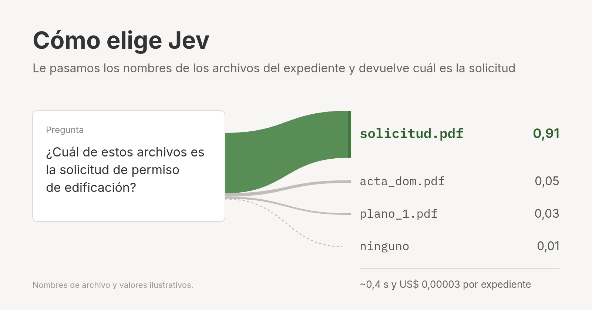
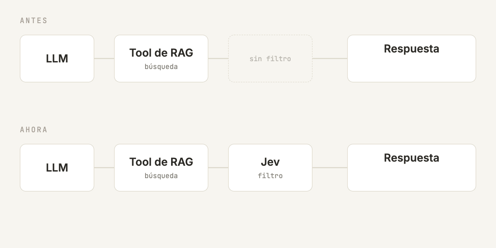

# Jevi: Jev bajó el 38% de gasto en Revi

La semana del 18 (de septiembre), probablemente mientras te comías una empanada, se lanzó Jev. Un modelo que abrió un submundo para todos los que estamos trabajando desarrollando agentes.

## ¿Quién es Jev?

Jev es un modelo de decisión de [TypeSafe AI](https://typesafe.ai/blog/introducing-system-one-models-and-jev). A diferencia de un LLM, en cambio de devolver texto, devuelve una decisión: le pasas una lista de alternativas y te devuelve la más probable. Le caben unos 32 mil tokens de texto por consulta, que es más o menos un libro corto como El Principito.

El público se volvió loco, Twitter estalló. Vieron en Jev un modelo generalista que toma decisiones muy rápido y no tardaron en encontrar casos de uso entretenidos (y realmente útiles). Además, como es inevitable, salieron varias copias que incluso pueden ser mejor que Jev. Como [Clef](https://blog.cloudflare.com/clef-decision-models/) de Cloudflare y otros open source como [Laya, Nimble y Kev](https://www.deeplearning.ai/the-batch/models-built-to-do-one-thing-well), y hace poco la [Decisions API de OpenAI](https://community.openai.com/t/decisions-api-is-now-available-in-public-beta/1403877).

Lo bacán de estos modelos es que nos permiten hacer estas elecciones a un nivel parecido al de los mejores LLMs de ahora mismo.

Si te interesa saber más sobre esto, pídele a tu ChatGPT o a Claudito que te expliquen sobre fast y slow thinking ([*Pensar rápido, pensar despacio*](https://es.wikipedia.org/wiki/Pensar_r%C3%A1pido,_pensar_despacio), de Kahneman) y los System 1 y System 2.

## Dónde lo usamos en Revi

En Revi, obviamente, no nos queríamos quedar atrás. Y el patrón es fácil de reconocer: cada vez que le pedimos a un LLM que elija entre opciones que ya conocemos, ahí puede ir Jev. Así que buscamos esos lugares y probamos meterlo.

### Reconocer documentos

Un expediente de permiso de edificación trae decenas de archivos. Para empezar, Revi necesita saber cuál es la solicitud (el formulario de la solicitud, un estándar del Minvu) y cuál es el acta de observaciones de la DOM (la muni). Antes se lo preguntábamos a Gemini. Ahora Jev elige entre los nombres de los archivos, más una opción «ninguno». Tarda unos 0,4 segundos, antes aprox 3 segundos, y cuesta US$ 0,00003 por expediente. Si falla, responde Gemini como antes.

### Filtrar la normativa

Cuando alguien pregunta por normativa, el agente busca en una base vectorial con la LGUC, la OGUC, los planes reguladores y las DDU (circulares). Como sabrás, esto es un RAG de toda la vida (3 años). Cada búsqueda trae varios fragmentos y todos entran al contexto, sirvan o no. La entrada del LLM es casi todo nuestro gasto: en nuestros evals, 4,3 millones de tokens de entrada contra 45 mil de salida.

Ahora, después de cada búsqueda, Jev revisa fragmento por fragmento si ayuda a responder la pregunta, y solo pasan los que sí:

En 20 preguntas de Puerto Varas, **los tokens de entrada bajaron 43 % y el costo 38 %**, con prácticamente la misma tasa de aprobación: 18,5 de 20 contra 19. Donde más se filtra es en los planes reguladores (a.k.a. PRC): de diez fragmentos por búsqueda, suelen servir dos.

## Lo que no funcionó

También probamos Jev en dos lugares más, con conversaciones y expedientes reales de Revi. Ninguno salió como esperábamos.

### Elegir herramientas

El agente de Revi tiene unas 50 herramientas, y probamos que Jev eligiera cuál usar en cada paso. Le achuntó a la misma que eligió el agente solo 4 de cada 10 veces, menos que si siempre respondiera sin usar ninguna. Y cuando sí había que usar una, acertó menos de 2 de cada 10.

También probamos algo más fácil: que Jev solo dijera si un mensaje se puede responder sin buscar nada, como cuando el usuario pide un resumen. Para no saltarse nunca una búsqueda que hacía falta, reconoció solo 12 de los 71 mensajes que se podían responder sin buscar.

### Podar el historial

Los subagentes que revisan un expediente leen en cada paso todo lo que trajeron sus herramientas antes, aunque ya no les sirva. Probamos que Jev decidiera qué botar.

No sirvió: los tokens no bajaron y el costo subió 7 %. Y revisó un poco peor: revisamos 15 ítems de expedientes reales, 3 veces cada uno, y comparamos con lo que observó el revisor de la DOM. Sin Jev coincidieron 24 de esas 45 revisiones; con Jev, 21.

---

Si estás haciendo agentes, revisa cuántas de tus llamadas al LLM son en verdad una elección entre opciones que ya conoces. O haz copycat de lo que hicimos: si usas RAG, filtra los resultados con Jev o algo similar, y si necesitas clasificar cosas, Jev es una salida muy fácil y rápida.
