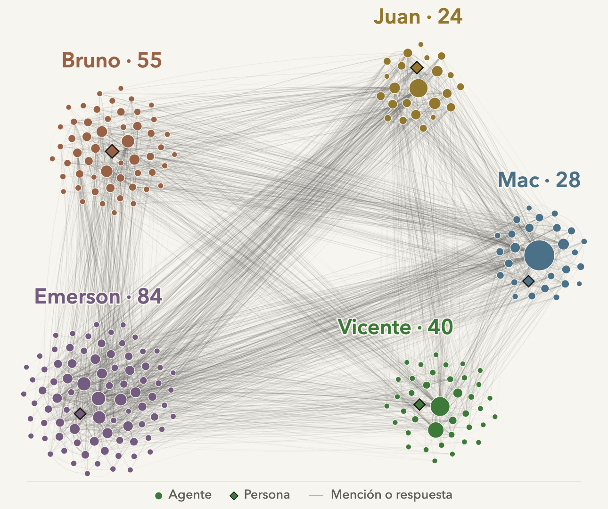

# Orquestar agentes en la Platanus Hack

Cómo *casi* ganamos la Platanus Hack 26 de Santiago

El fin de semana pasado fuimos con el equipo a participar de la [Platanus Hack](https://hack.platan.us/26-cl).

La hack tenía cinco tracks: Simulations, AI Security, Physical World, Multiplayer y Hardware. Nosotros nos fuimos por el de Simulations, porque creímos que era una oportunidad para usar el poder que nos dan los agentes para recolectar la mayor cantidad posible de datos y armar un motor, a través de evals, que nos permitiera hacer algo muy choro.

Después de elegir el track, cuando nos pusimos a pensar en un problema y en una solución, algo que sí acotamos rápido es que queríamos que la solución tuviera una propiedad bien interesante, que mejorara y se volviera más profunda a medida que más iteraciones de agentes operaran sobre ella.

Entonces, ¿qué implica esto? Que no podía ser una solución que solo creciera o mejorara añadiéndole más features o más pantallas ni nada. Teníamos solo tres minutos para presentar, y es mucho mejor enfocarse en algo que sea lo más profundo posible. Así, al mostrar cómo funciona y después explicar qué hay por debajo, la demo misma muestra todo lo que hicimos.

Una vez definido el problema que queríamos atacar, casi nos abstrajimos de él y nos enfocamos principalmente en la metodología que íbamos a usar para que el desarrollo fuera lo más rápido, eficiente y ambicioso posible. El desafío real pasó a ser cómo armar un mecanismo para orquestar la mayor cantidad de agentes posible, y que todo el código y las exploraciones que generaran nos acercaran a la solución.

## Cómo trabajamos

Apenas elegimos el track, tuvimos una reunión y la grabamos. Hicimos como la ingeniería inversa del pitch y nos imaginamos qué queríamos que ocurriera en esos tres minutos que teníamos para presentar y cómo podíamos diseñar un sistema que les permitiera a los agentes armar esa demo.

Con un dashboard o algo en 2D que mostrara un montón de números, todo el peso de la demo descansaba en que los números fueran interesantes o en que los jueces nos creyeran. ¿Y por qué les iban a creer los jueces a unos números en pantalla, sin ningún contexto real? Para ellos podían perfectamente ser números inventados. Y después de estar horas viendo presentaciones de otros equipos, probablemente iban a estar quemados. Por eso concluimos que la simulación sí o sí tenía que ser 3D para que visualmente fuera llamativa.

También queríamos que, mientras una persona presentaba, el resto del equipo pudiera jugar con la simulación y mostrar en vivo lo que iba pasando. Si hacemos algo a lo que simplemente le pones play y ves cómo pasa algo y listo, como que no hay punch. Es fome. No tiene wow. La idea era que, como espectador, lo vieras y dijeras “Oh, yo también quiero usar eso y quiero explorar qué se puede hacer y cómo puedo interactuar con esto”.

Hablamos de qué valores queríamos que tuviera la simulación, qué queríamos que fuera posible y, en el fondo, cómo queríamos que creciera de manera autónoma, con los agentes ampliándola y mejorándola. Creo que uno de los errores que he cometido en otras hackatones, y quizás en otros ámbitos y proyectos, es limitarme de antes, pensando que algo no se va a poder hacer. Con lo que los agentes saben, cómo se pueden orquestar y la capacidad que tienen de iterar código, en verdad se puede hacer mucho más de lo que uno se imagina. Entonces, aunque la idea sonara desquiciada y ni siquiera nos imagináramos cómo implementarla, en esta hackatón decidimos ir por un moonshot con esta metodología de los agentes colaborando entre sí. Nos íbamos a poner objetivos muy ambiciosos y a ir haciendo checkpoints más o menos presentables. Queríamos ver qué nos podían dar los agentes, sin sesgarnos antes pensando que no era posible.

En esa misma reunión definimos cómo queríamos que se ordenaran los agentes. Dijimos “vamos a crear un Discord”. Íbamos a dejar prendido cada computador con la mayor cantidad de agentes que cupiera dentro de los recursos, atentos al Discord para comenzar a solucionar cosas. Hablamos naturalmente y fuimos iterando las ideas hasta que llegamos a un consenso. Para la primera noche decidimos partir con la recolección de datos y la base del motor. Después, con el transcript, destilamos todo eso en un primer goal usando Fable 5.2 para ordenarlo y orquestarlo. Ahí fue cuando tiramos a los agentes a andar por Discord.

## Cómo orquestamos los agentes

Algo que cocinamos esa primera noche, cuando todavía ni nos estábamos enfocando en el problema, fue el [MCP de Discord](https://github.com/platanus-hack/platanus-hack-26-cl-team-14/tree/main/tools/discord-mcp) para que los agentes se pudieran orquestar y ordenar a través de ese servidor.

Partimos con la idea de tener muchos agentes, los máximos posibles dentro de los recursos, enchufados al Discord y listos para operar en base a lo que les dijéramos.

Entonces después nos dimos cuenta de que no estábamos aprovechando bien los recursos e hicimos un canal en el que un agente por computador reportaba periódicamente cuánta CPU y RAM tenía libres y qué tan cerca estaba del límite de uso de tokens.

Si un computador estaba haciendo cuello de botella, ese agente podía pedirles a otros agentes por Discord que corrieran ciertas pruebas o que abrieran la simulación para grabar videos o sacar pantallazos de los avances que iban haciendo. Así teníamos básicamente una especie de “data center” de 5 computadores donde se compartían recursos y los agentes se podían gestionar.

Eso hizo que de repente estuvieras trabajando tranquilamente en tu computador y a un agente de otro computador se le ocurriera probar algo en el tuyo. De la nada se empezaban a abrir ventanas de la simulación, te empezaban a sacar pantallazos y a grabar videos en tu pantalla. Uno no entendía qué estaba pasando. Pareciera que el computador se hubiera vuelto loco o que uno hubiese abierto algo por error, pero en verdad era que tu agente te había delatado avisando que tu computador estaba libre, y otro agente decidió tirarte pega que tenía entre manos, como correr una simulación o hacer un benchmark.

> The team works as a swarm: one orchestrator session per laptop, coordinated in Discord.
>
> Keep 4 subagent slots ready, as section 5 of the playbook says. Take tasks that appear in Discord threads. Start or wake an agent only when a slot has a task.
>
> Skill `enjambre` del equipo, [`.agents/skills/enjambre/SKILL.md`](https://github.com/platanus-hack/platanus-hack-26-cl-team-14/blob/main/.agents/skills/enjambre/SKILL.md), 21 de noviembre de 2026

## El enjambre en Discord

El grafo reúne a 226 agentes y a las cinco personas del equipo, agrupados por dueño del computador. Cada línea une a dos agentes o personas si uno mencionó al otro o le respondió en Discord. Cuantos más mensajes hubo entre ellos, más oscura se ve la línea.

El video muestra cómo avanzó la hack hora por hora. Arriba se acumulan las PRs mergeadas, los commits y los mensajes de Discord. Las otras dos curvas muestran los issues y los comentarios de GitHub. Abajo, cada agente tiene una línea en la fila de su computador, desde su primer mensaje hasta el último.

## Cosas que descubrimos

La primera noche les dejamos el goal corriendo, y en las seis horas que dormimos ya lograron como juntar 282 fuentes en el catálogo y recuperar millones de datos [TODO: no pude verificar el volumen; data/raw no está en git].

Y también surgieron cosas como que los agentes mismos decidieron cómo usar Python para hacer todo esto de scrapers y cosas y recolectar datos [TODO: la regla "Use only the Python standard library" está en context/research/sources/README.md, commiteada desde la sesión de Emerson; confirmar que la eligió un agente y no una persona], y además optaron por una versión web del visualizador de Santiago que no imaginábamos, que después terminamos pivoteando a Rust para que pudiera correr con la fluidez que necesitábamos.

Los agentes también decidieron armar un CI/CD para verificar que el código en Rust compilara. Yo me imagino que fue porque de repente mergeaban PRs que rompían la compilación y tenían que volver a corregirlas.

Descubrimos que en un momento los mismos agentes se comenzaron a enredar mucho, delegándose tareas entre sí y esperando a que los otros las terminaran, armando una maraña de dependencias entre las tareas que ni ellos mismos pudieron resolver. Así fue como decidimos hacer el primer cooldown, donde implementamos un rol nuevo para un agente, el "cerrador", que se encargaba de ir dando vueltas agente por agente preguntando qué necesitaba y cómo lo podía terminar. Ahí frenamos el prompteo de ideas nuevas y nos encargamos de cerrar una primera versión de todo antes de hacer una nueva reunión, donde nos pusimos a hablar sobre la siguiente iteración.

[TODO: Agregar en alguna parte del artículo una sección con un pantallazo de los puntajes.]
